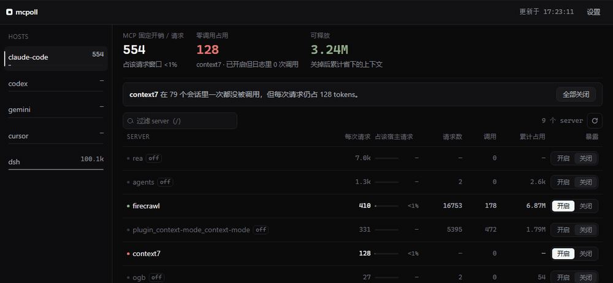
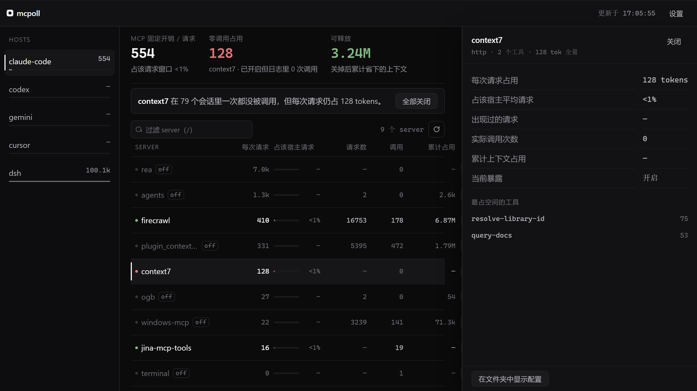
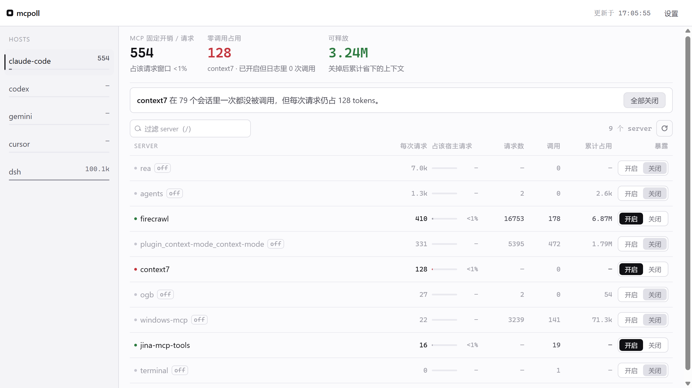

# mcpoll

**See what each MCP server costs in your context — and turn off the ones you never call.**

A local panel and CLI. It reads the session logs your agents already write, works out how many tokens
each MCP server's tool definitions occupy per request, counts how often each one is actually called,
and flips individual servers on or off per host.



*Switching a never-called server off drops the per-request cost from 554 to 426 tokens. Nothing is written until you press save.*

<details><summary>More screenshots</summary>





</details>

No proxy, no daemon, no prompt rewriting, no guessing.

---

## The problem

MCP tool definitions are injected into the model's context. They are re-sent on **every request**, so a
server you installed months ago and never call is still being paid for, once per turn, forever.

Measured on the author's machine:

| what | number |
|---|---|
| `rea` (229 tools) in one host | **100.1k tokens / request** — 39% of the request window |
| `firecrawl` in Claude Code | 410 tokens / request, 178 real calls |
| `context7` in Claude Code | 128 tokens / request, **0 calls in 79 sessions** → ~3.24M tokens spent for nothing |

That last row is the whole product: not "MCP is expensive", but "this specific server, on this specific
host, cost you this much and was never used".

## What it does

Two things, and it tries hard to do nothing else:

1. **Measure.** Parse the local session logs of each agent, price every MCP server's tool schema per
   request, and count real tool calls per server.
2. **Switch.** Set a server to `native` or `off` for a given host. Writing back to the host's config
   file is backed up first (`.backups/`, timestamped) and limited to the hosts you touched.

## What it deliberately does not do

| rejected | why |
|---|---|
| **Capture proxy / traffic interception** | Invasive, and the logs already contain what is needed. If a host writes no usable log, mcpoll shows call counts and says so — it does not invent numbers. |
| **Tool-level filtering, schema compression, meta-tools** | A/B tested on a real host: a meta-tool wrapper kept tool use correct but turned a 21 s / 2-step task into 122 s / 12 steps. Static subsets were worse — the model could not see the tool and fell back to hand-written shell, then got the answer wrong. Compression was a no-op because hosts re-strip the schema themselves. |
| **Editing prompts / upstream MCP servers** | Out of scope by design. |
| **A resident daemon** | `node bin/ui.mjs` serves loopback; close it and it is gone. The desktop app kills the server when the window closes. |

## Host support

*Measured* means the log contains both tool definitions and token counts for the same request. Where it
does not, mcpoll shows call counts only — those columns are not rendered at all, they do not show `0`.

| host | log it reads | cost | switch |
|---|---|---|---|
| **Claude Code** | `~/.claude/projects/**/*.jsonl` → `api-request-shape` | ✅ measured (deferred: tool names only, ≈10.5 tok/tool) | ✅ writes `~/.claude.json` |
| **DSH** | `~/.dsh/sessions/**/session.v4.jsonl.zstd` → `request/header` (multi-frame zstd, decoded per frame) | ✅ measured (inline schema, 0.2293 tok/char) | ⚠️ plan only — prints the change, does not edit the YAML |
| **Codex CLI** | `~/.codex/sessions/**/rollout-*.jsonl` → `function_call` | ❌ tool definitions appear in only a handful of records and cannot be paired per request | ✅ edits `config.toml` by section |
| **Gemini CLI** | — no session log on disk | ❌ | ✅ edits `settings.json` |
| **Cursor** | — no session log on disk | ❌ | ✅ edits `mcp.json` |

The switch side is uniform; the measurement side is honest about what each host actually writes.

## Install

Requires Node ≥ 20.

```bash
git clone https://github.com/chow651/mcpoll
cd mcpoll
npm install
npm run ui          # http://127.0.0.1:7777 — close the tab, the process is gone
```

Or without cloning:

```bash
npx -p github:chow651/mcpoll mcpoll status
```

First launch seeds `registry.example.json` into your data dir, then probes the configured servers once,
in the background. Until that finishes the panel shows dashes, not zeros.

### Desktop app

```bash
npm run desktop     # run the window directly
npm run dist        # build an installer → release/mcpoll Setup <version>.exe
```

The shell is ~130 lines (`desktop/main.cjs`): spawn `bin/ui.mjs --port 0`, point a window at it, kill the
child on close. No IPC bridge, no second implementation.

Runtime data lives in `%APPDATA%/mcpoll/data` (Windows) or `~/Library/Application Support/mcpoll/data`:

```
registry.json      desired state per host — what you want exposed
calibration.json   chars→tokens factor per host
.cache/            probe snapshot + per-host ledger cache
.backups/          every host config file we touched, timestamped
.audit.log         one line per registry write
```

## CLI

```bash
node bin/tax.mjs                 # the ledger, per host
node bin/tax.mjs --host dsh      # one host only
node bin/tax.mjs --refresh       # re-probe every server (network)
node bin/mcpoll.mjs matrix       # host × server switch matrix
node bin/mcpoll.mjs status       # current config vs desired state
node bin/mcpoll.mjs plan         # what would change
node bin/mcpoll.mjs apply --dry-run
node bin/mcpoll.mjs apply        # write it (backup first)
```

## How the numbers are produced

The unit is **per request**, not per session: context is rebuilt every turn, so cost = per-request
footprint × number of requests. Multiplying by session count understates it by an order of magnitude.

- **Tool schema size** comes from probing the server itself (`tools/list`), normalised to
  `{name, description, parameters}` because hosts strip `title` / `outputSchema` / `annotations` anyway.
- **chars → tokens** is per host, because tokenizers differ. Two regimes exist and one number hides that
  badly: `inline` (schema rides in every request) and `deferred` (only names/placeholders). Both are
  recorded per host. `bin/calibrate.mjs` measures a host by registering a fake MCP server at several
  schema sizes and fitting the slope against that host's own token counts.
- **Call counts** come from the log. Tool names logged bare (`resolve_library_id`) are mapped back to
  their server through the probe list, with `-`/`_` normalised; a name claimed by two servers is dropped
  rather than guessed.

A `—` means "not measurable here", never zero.

## Limits

- The shipped factors were measured on the author's machine and models. Tokenizer ratios differ between
  model families; re-run `bin/calibrate.mjs` for yours. The settings panel shows the factor and its
  provenance for every host.
- Hosts that write no usable log (Gemini CLI, Cursor) can be switched but not priced.
- JSON-configured hosts are rewritten whole-file, so comments in those files are lost (the UI warns).
- DSH's config is a hand-maintained YAML patch file; its switch is plan-only on purpose.
- Developed and tested on Windows. The macOS/Linux code paths are the same but untested — reports welcome.
- No OAuth flows; remote HTTP servers reuse whatever token is already in the host config.

## FAQ

**Does it send anything anywhere?** No telemetry. It reads local files and, when you probe, sends a
`tools/list` request to the MCP servers you listed yourself.

**Why not a proxy?** Because the question is "what am I paying for", and the logs already answer it.
A proxy adds a process in the path of every tool call and would still need the same log parsing.

**Why is Codex not priced?** Its rollout logs contain 1,364 usage records with real token counts, but
tool definitions appear in only a handful of records and cannot be aligned per request. Pricing it would
mean fitting a coefficient and calling it a measurement. It shows call counts instead.

**Can I trust the "0 calls" flag?** It means "no call recorded in the logs on this machine". A server you
did not use in the last month may be essential next month — the flag is a hint, not a verdict. mcpoll
never changes a switch on its own.

## Roadmap

Kept deliberately small, and each item is its own thing:

- **A gateway plugin (separate project).** A local LLM gateway sees every request and knows the provider's
  price table, so it can produce the money half of this bill for clients mcpoll cannot parse. Its audit
  stores counters rather than tool declarations, so it cannot split that money per server — but magpie's
  Bun request hooks do hand a plugin the parsed request body (tool declarations included) and the finished
  reply, so the split is buildable there. It stays a separate project: mcpoll has to keep working for
  people who run no gateway at all.
- **English UI.** The panel is Chinese; every string is inline in `ui/app.js` and `ui/index.html`.
- **A calibration table across model families**, instead of factors measured on one machine.

## Contributing

Issues and PRs welcome — especially more log formats, and an English UI (the panel is Chinese today;
every string lives in `ui/app.js` and `ui/index.html`).

See [CONTRIBUTING.md](CONTRIBUTING.md).

## License

MIT © 2026 chow651

---

## 中文

**看 MCP 在上下文里到底花了多少 token，然后按宿主开关。**

MCP 的工具定义每轮请求都会重新塞进上下文。一个装了几个月、一次没调过的 server，照样每轮都在收费。

作者机器上的实测：

| | |
|---|---|
| `rea`（229 个工具）在某个宿主里 | **10.0 万 token / 请求**，占请求窗口 39% |
| `context7` 在 Claude Code 里 | 128 token / 请求，79 个会话里 **0 次调用** → 白付约 324 万 token |

只有两件事：

1. **计量** —— 读各宿主自己写的会话日志，算出每个 MCP server 每次请求占多少、真被调用了多少次。
2. **开关** —— 按宿主把 server 设成 `native` / `off`，写回宿主配置，写前备份。

不做：抓包代理、工具级过滤、schema 压缩、改提示词、常驻守护进程。前几项都实测过，收益是负的
（meta 工具把 21 秒 2 步的任务拖成 122 秒 12 步）。

**算不准就不算**：日志里凑不齐「工具定义 + token 计数」的宿主（Codex / Gemini / Cursor）不渲染
任何成本、占比、累计占用，只显示调用次数。`—` 的意思是「这里测不出来」，不是 0。

```bash
git clone https://github.com/chow651/mcpoll && cd mcpoll && npm install
npm run ui        # 看板，关掉即结束
npm run dist      # 打包成桌面应用
node bin/tax.mjs  # 命令行账本
```

数据在 `%APPDATA%/mcpoll/data`：`registry.json`（想要的开关状态）、`calibration.json`（每宿主系数）、
`.cache/`、`.backups/`、`.audit.log`。
